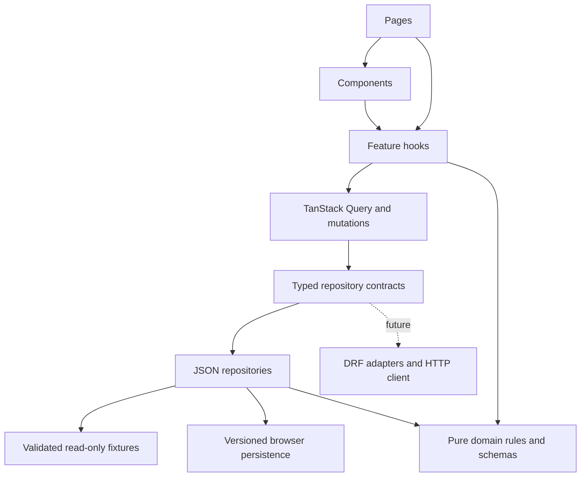
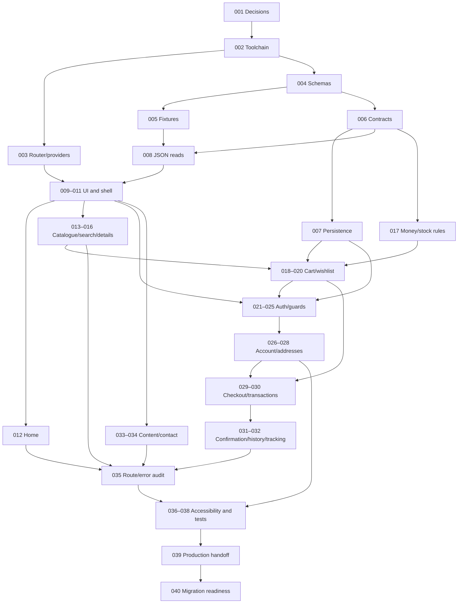

# bdsolarenergy.com — development plan

Status: planning only. No application implementation is authorized by this document. Complete the planning review, then authorize individual tasks separately.

## 1. Executive summary

Build a mobile-first Bangladesh solar and electrical storefront with React, TypeScript, and Vite. Customers can discover products, compare specifications, maintain a cart and wishlist, use clearly labeled demo accounts, check out without real payment, and review locally persisted orders. The first release uses structured JSON fixtures and browser persistence exclusively. Feature-facing repository contracts allow later Django REST Framework (DRF) integration without rewriting presentation or business rules.

Deliver in dependency order: establish tooling and contracts, validate fixtures, build shared presentation and catalogue, add persistence and accounts, integrate checkout and orders, then complete accessibility, testing, and migration review. A public administration area is excluded; customers cannot edit catalogue fixtures through the storefront.

## 2. Requirements and assumptions

Required: every route in section 8; JSON-first data access; reusable business rules; BDT totals; stock-aware checkout; deterministic demo behavior; accessible responsive UI; automated checks; documented API replacement boundaries.

Assumptions: English interface initially, with internationalization-friendly labels and Unicode Bangladesh names/addresses; BDT only; prices include any applicable fixture-configured tax; delivery within Bangladesh; optional account required for checkout and order history; guest browsing, cart, and wishlist supported. Product reviews are read-only. No real payment, email, SMS, shipment, password recovery, or backend deployment is included.

Demo product prices, stock, store contacts, warranty terms, and policies must be visibly sample content until the owner approves replacements. Never imply a simulated order reached a merchant. Checkout shows a demo notice before submission and on confirmation.

## 3. Technology stack and rationale

| Tool | Role and version policy |
| --- | --- |
| React + React DOM | Component rendering; select matching stable versions at implementation |
| Vite + TypeScript | Development server, production bundling, strict type checks; pin supported Node LTS |
| React Router | Nested routes, route guards, query strings, redirect restoration |
| Tailwind CSS | Shared tokens and responsive styling; use its current documented Vite integration |
| TanStack Query | Repository reads, mutation state, invalidation, eventual remote caching |
| React Hook Form + Zod | Forms, shared runtime validation; resolver integration dependency permitted |
| Lucide React | Consistent accessible decorative icons |
| Vitest + React Testing Library | Domain, repository, hook, and interaction tests |
| Playwright | Browser journeys and responsive regression checks |
| ESLint + Prettier | Static quality and formatting |

Resolve compatible stable releases in TASK-002, record exact versions and engine range, and commit one npm lockfile. Do not guess future package versions. Additional development dependencies: jsdom, user-event, testing-library matchers, TypeScript ESLint support, and an accessibility test integration if compatible. These enable tests and linting; no UI kit, Redux, date library, payment SDK, or backend dependency is necessary.

## 4. High-level architecture



Components never import fixtures, access storage, or make network requests. Services never depend on React. Pages compose hooks and reusable components. Domain functions operate on typed inputs and return values or typed errors. A composition root selects repository implementations once; no feature checks an adapter mode.

All reads return promises even for fixtures. Normalize failures as `validation`, `not_found`, `conflict`, `unauthenticated`, `forbidden`, `storage_unavailable`, or `unavailable`, with safe messages and optional field errors. Only transient read failures retry; validation/auth failures and non-idempotent mutations do not automatically retry.

## 5. Proposed directory structure

```text
src/
  app/{router,providers,layouts}/
  components/{common,navigation,products,cart,forms}/
  features/{auth,products,categories,cart,checkout,orders,wishlist,account,search,content}/
  services/
    contracts/
    json/
    http/
    api/                 # added during future backend integration
    persistence/
    container.ts
  domain/{catalogue,cart,checkout,auth,orders}/
  data/{products,categories,banners,navigation,reviews,users,orders,coupons,shipping,site-settings,pages,payment-methods}.json
  hooks/
  schemas/
  types/
  utils/
  styles/
  main.tsx
tests/{fixtures,contracts,integration,e2e}/
docs/{architecture,data,api,testing}/
```

Keep feature-only components alongside their feature. Promote a component when it has a stable shared responsibility. Avoid empty directories or speculative adapters. Cross-feature imports use public exports; infrastructure imports no UI modules.

## 6. Data model and JSON fixture design

Use stable string IDs and unique slugs; relationships use IDs. ISO timestamps use UTC. Monetary amounts are integer poisha; format BDT using `Intl.NumberFormat` and convert only at the display boundary. Quantities are integers. Product variants represent purchasable SKUs; every product has at least a default SKU.

| Fixture/entity | Key fields and relationships | Mutability |
| --- | --- | --- |
| Categories | id, slug, name, parentId, imageId, sortOrder | Fixture |
| Products | id, slug, categoryId, brandId, name, summary, description, imageIds, specification entries, variantIds, tags, createdAt | Fixture |
| Variants/inventory | id, productId, sku, attributes, price, compareAtPrice, stock, maxPerOrder, weight | Fixture baseline; local order reservations separately |
| Images | id, local source, alt, width, height, attribution | Fixture; use licensed local assets |
| Brands | id, name, slug | Fixture |
| Reviews | id, productId, displayName, rating 1–5, title, body, createdAt | Fixture; derived average/count |
| Banners | id, title, copy, imageId, CTA label/path, active interval | Fixture |
| Navigation | id, label, internal path, parentId, order | Fixture |
| Users | id, displayName, email, demo identity metadata | Seed, local profile overlays |
| Addresses | id, userId, recipient, phone, division, district, area, street, postcode, default | Local |
| Cart lines | variantId, quantity; owner key guest or userId | Local; never trust saved prices |
| Wishlists | owner key, unique productIds | Local |
| Orders/items | id, userId, idempotencyKey, status, address snapshot, product/SKU/price snapshots, totals, method IDs, timestamps, tracking events | Local; immutable purchase snapshots |
| Coupons | id, code, type, amount, minimumSubtotal, maximumDiscount, startsAt, endsAt, eligibleCategoryIds | Fixture |
| Shipping | id, label, supported districts/zones, fee, freeAbove, estimated days | Fixture |
| Payment methods | id, label, description, enabled, demoOnly | Fixture; COD/mobile finance/card simulations |
| Site settings | store contacts, currency, feature collections by product IDs, minimumOrder, tax policy, demo notice | Fixture |
| Content pages | slug, title, sections, updatedAt; FAQ entries | Fixture |

Related records can be nested in a fixture when owned exclusively, but IDs still identify images, variants, and addresses. Validate references, unique IDs/slugs/SKUs, category cycles, money constraints, discount bounds, valid dates, and navigation destinations in tests.

Seed at least 40 products across all eight listed product groups, including panels, inverters, batteries, controllers, accessories, cables, protection devices, and switches/sockets. Include at least four brands, nested categories, multi-variant products, low/out-of-stock items, discounted/new/featured/best-selling products, enough results for three catalogue pages, multiple reviews, two delivery zones, three demo payment types, and active/expired/ineligible coupon cases. Include deterministic empty and malformed repository test fixtures, never random runtime failures.

Storage envelope: `{ version, updatedAt, data }` under a namespaced key per aggregate. Parse with Zod, migrate known old versions, discard only the corrupt aggregate with an explanatory notice, and preserve unrelated keys. Missing values use fixture/default seeds. Unknown future versions produce a recoverable reset notice. Explicit “Reset demo data” requires confirmation and removes only this application's keys. Never write imported JSON in the browser.

Fixture accounts are explicitly public demonstrations. Demo login uses a documented shared demo passphrase held in memory/module configuration, never persisted as a credential. Registration creates a local identity using a Web Crypto salted verifier for demo password comparisons; never store plaintext passwords. Verifiers remain browser-controlled and provide no real authentication security. Password fields clear on submission/unmount and never enter logs. Persist identity ID and expiry only for remembered sessions; otherwise use session storage. Restore identity only if it still exists and has not expired.

## 7. Repository contracts and JSON-to-API migration strategy

All operations return `Promise<T>` and accept optional cancellation signals for reads. Proposed signatures below are design contracts, not application implementation.

| Contract | Operations |
| --- | --- |
| CatalogueRepository | listProducts(ProductQuery) → Page<ProductSummary>; getProduct(slug); listCategories(); getReviews(productId) |
| ContentRepository | getSiteSettings(); getNavigation(); getBanners(); getPage(slug); getCheckoutConfiguration() |
| AuthRepository | getSession(); login(LoginInput); register(RegisterInput); logout(); requestReset(email); resetDemoPassword(input); getVerificationStatus(); changeDemoPassword(input) |
| CustomerRepository | getProfile(); updateProfile(input); listAddresses(); saveAddress(input); deleteAddress(id); updatePreferences(input) |
| CartRepository | getCart(); setQuantity(variantId, quantity); removeLine(); clear(); mergeGuestCart(userId) |
| WishlistRepository | list(); toggle(productId); mergeGuestWishlist(userId) |
| OrderRepository | quote(CheckoutInput); placeOrder(CheckoutInput, idempotencyKey); listOrders(PageQuery); getOrder(id); getTracking(id) |

`ProductQuery`: text, categoryId (including descendants), brandIds, minimumPrice, maximumPrice, availability, collection, sort, page, pageSize. `Page<T>`: items, total, page, pageSize. Domain entities differ from wire DTOs. Mutations return updated authoritative aggregates; hooks invalidate related reads. `placeOrder` revalidates the complete quote, never accepts a trusted UI total.

Composition root supports a validated `VITE_DATA_SOURCE=json` initially. Unsupported modes fail clearly; never silently fall back from a failed API to fixtures. Future `VITE_API_BASE_URL` is public configuration, never a credential. API mode is implemented only when a backend contract exists.

Proposed DRF endpoints: `/products/`, `/categories/`, `/products/{slug}/`, `/auth/session/`, `/auth/login/`, `/auth/logout/`, `/customers/me/`, `/addresses/`, `/cart/`, `/wishlist/`, `/orders/`, `/orders/{id}/`, `/checkout/quote/`. These are proposals requiring backend agreement. Map DRF `{count,next,previous,results}` to `Page<T>` and query parameters in adapters. Normalize field/non-field errors, money representation, timestamps, identifiers, and permissions. Pass `AbortSignal` through fetch. Configure bounded read retry and stale times; clear account-scoped cache on logout.

Backend session choice remains open: prefer HttpOnly secure cookies if deployment supports them, with CSRF acquisition/header and credentialed CORS configuration agreed with backend. If token sessions are selected, define renewal/revocation and avoid long-lived browser storage tokens. Never bake private keys into Vite variables. Backend owns password hashing, authorization, inventory consistency, coupon limits, and payment/webhook verification.

Run identical repository behavior tests against JSON adapters and a future API test harness. Add DTO schema tests and transport tests for cancellation, pagination, 401/403/422/429/500, CSRF and idempotency. UI, feature hooks, domain rules, and entity types should remain unchanged except for deliberate contract evolution.

## 8. Complete route and page inventory

Access: public (P), guest-only (G), authenticated (A). Every page uses a shared shell and loading/error/empty handling. Route TASK IDs map to section 16.

| Route | Purpose/access | Dependencies | Key interaction | Task |
| --- | --- | --- | --- | --- |
| `/` | Home, P | banners, categories, collections, reviews | Shop collections/hero CTA | 012 |
| `/products` | All products, P | catalogue | Filter/sort/page | 013–014 |
| `/category/:categorySlug` | Category, P | category tree, catalogue | Descendant/category filtering | 013 |
| `/category/:categorySlug/:subcategorySlug` | Subcategory, P | validated parent relationship | Narrow results | 013 |
| `/search?q=` | Search, P | catalogue | Suggestions, results | 015 |
| `/featured` | Featured collection, P | settings product IDs | Browse | 013 |
| `/best-sellers` | Best sellers, P | configured popularity | Browse | 013 |
| `/new-arrivals` | New items, P | creation timestamps | Browse | 013 |
| `/offers` | Discounted products, P | prices | Browse offers | 013 |
| `/product/:slug` | Product details, P | product, variants, reviews | Select SKU/quantity, add cart/wishlist | 016 |
| `/cart` | Cart, P | cart, live catalogue | Update/remove/clear, coupon quote | 019 |
| `/wishlist` | Wishlist, P | wishlist, catalogue | Remove/add to cart | 020 |
| `/checkout` | Checkout, A | cart, addresses, shipping, payments | Quote/validate/place | 029–030 |
| `/order-confirmation/:orderId` | Confirmation, A | owned order | See reference and demo notice | 031 |
| `/login` | Login, G | demo auth | Login, return-path redirect | 022 |
| `/register` | Register, G | demo auth | Validate/register | 023 |
| `/forgot-password` | Reset request, G | demo auth | Generic simulated response | 024 |
| `/reset-password` | Demo reset, G | local reset intent | Explicit demo-only reset | 024 |
| `/verify-email` | Verification status, P | demo status/session | Show simulated state | 024 |
| `/logout` | Logout action screen, A | session | Cleanup, redirect home | 025 |
| `/unauthorized` | Denied state, P | none | Sign in/return home | 025 |
| `/account` | Dashboard, A | profile/orders | Navigate account | 026 |
| `/account/profile` | Profile view, A | profile | View/edit link | 026 |
| `/account/profile/edit` | Profile editor, A | profile | Validate/save | 026 |
| `/account/password` | Change demo password, A | auth | Validate current/new | 024 |
| `/account/addresses` | Address book, A | addresses | Default/delete with confirmation | 027 |
| `/account/addresses/new` | New address, A | geography settings | Validate/save | 027 |
| `/account/addresses/:addressId/edit` | Edit address, A | owned address | Save/cancel | 027 |
| `/account/orders` | History, A | owned orders | Page/open order | 032 |
| `/account/orders/:orderId` | Order details, A | owned snapshot | View totals/items | 032 |
| `/account/orders/:orderId/tracking` | Demo tracking, A | tracking events | View static timeline | 032 |
| `/account/wishlist` | Account wishlist, A | user wishlist | Shared wishlist UI | 020,025 |
| `/account/settings` | Preferences/reset, A | customer settings | Save/reset confirmation | 028 |
| `/about` | About, P | content | Store background | 033 |
| `/contact` | Contact, P | store contacts | Validated demo inquiry | 034 |
| `/faq` | FAQ, P | FAQ fixture | Accessible disclosure | 033 |
| `/shipping-delivery` | Delivery policy, P | content | Read policy | 033 |
| `/returns-refunds` | Return policy, P | content | Read policy | 033 |
| `/warranty` | Warranty, P | content | Read policy | 033 |
| `/privacy` | Privacy, P | content | Read demo storage disclosure | 033 |
| `/terms` | Terms, P | content | Read terms | 033 |
| `*` | 404, P | none | Home/search recovery | 035 |

Invalid dynamic IDs/slugs render contextual not-found states, not blank pages. Guards preserve safe internal return paths only; guest-only pages redirect logged-in users to account. Access failures never disclose another customer's order/address. Deep links require production static-host SPA fallback, documented during build handoff.

## 9. Authentication and authorization boundaries

Auth state: initializing → guest → submitting → authenticated; expiry/logout return to guest. Restore sessions before evaluating guards to avoid flashes. Login failures keep fields except passwords and show a generic credential error. Registration normalizes email, validates duplicate addresses, confirms passwords, and accepts policy acknowledgement. Remember-me persists only session metadata with configurable expiry.

Guest cart/wishlist merge happens once on login: deduplicate by SKU/product ID, clamp combined quantity to stock/max limits, report reductions, and clear guest state only after success. Logout clears account cache/session and reveals the separate guest cart; it never exposes the prior user's data. Account mutations enforce local ownership for demo behavior, with explicit documentation that browser checks are bypassable.

Reset requests always return the same generic demo response; no email is delivered. A visible demo reset action creates an expiring one-use local reset intent, never claims a real emailed token. Verification status is simulated. Change-password demo updates only the local verifier. Backend migration replaces all these operations with server-enforced flows.

## 10. E-commerce business logic design

| Rule | Location | Required tests |
| --- | --- | --- |
| Case-insensitive trimmed search, category descendants, brand/price/availability intersection | domain/catalogue | Combined filters, unknown category, Unicode, no matches |
| Price/newest/popularity/rating sorting with stable ID tie-break | domain/catalogue | Ties, direction, derived rating, discounted price |
| Pagination after filtering/sorting | domain/catalogue | Bounds, empty page, filter resets page |
| SKU/variant quantity and inventory constraints | domain/cart | Zero/remove, negative/fractional rejection, max, out of stock |
| Wishlist uniqueness and merge | domain/cart | Toggle, duplicate merges, deleted products |
| Line/subtotal calculations using integer poisha | domain/cart | Multi-SKU totals, invalid money, overflow guard |
| Coupon validation and discounts | domain/checkout | Case normalization, dates, minimum, category eligibility, cap |
| Shipping and free-delivery thresholds | domain/checkout | District zones, unsupported address, threshold boundary |
| Checkout minimum and totals | domain/checkout | Empty, discount allocation, shipping, configured tax, nonnegative total |
| Order creation and stock reservation | services/json + domain/orders | Requote, stale price, duplicate submission, rollback |
| Address ownership/default selection | services/json + schemas | Ownership, one default, delete fallback |
| Review count/average | domain/catalogue | Zero reviews, bounded rating, deterministic rounding |
| Session transitions and expiry | domain/auth + auth repository | Restore, expire, logout, safe redirects |
| Currency formatting | utils | BDT symbol, decimals, no floating total arithmetic |
| Invalid/missing/deprecated persistence | services/persistence | Safe fallback, migrations, quota/read failures |

Calculation order: current SKU prices → line subtotal → eligible item coupon discount (capped at eligible subtotal) → shipping from configured zone/threshold (threshold based on discounted subtotal) → configured tax if any → total. Compare-at price is display-only and never discounted a second time. Defaults assume tax-inclusive prices and zero extra tax. A free-shipping coupon changes shipping only. Only one coupon per order; no implicit stacking.

On checkout review, repository returns a quote with line prices, discounts, delivery and expiry metadata. Submission revalidates catalogue prices, stock, coupon eligibility, address, and method. A changed price requires explicit review of a refreshed quote. Order items freeze product name, SKU, unit price, address, and amounts so later profile/catalogue changes cannot rewrite history.

Local order transaction stores order, reservation ledger, and cart change in one versioned checkout aggregate before confirming. Persist the idempotency key through retries; duplicate keys return the same order. Disable duplicate UI submission but do not rely on the button alone. Local transaction coordination prevents same-tab duplicates; cross-tab contention can be detected with revision checks and a reload prompt. Browser persistence cannot guarantee distributed inventory consistency; backend must provide atomic inventory/payment operations. Storage failure must leave a retriable cart and must not report a successful order.

## 11. UI/UX design system

Use navy `#0B2545` for navigation/headings, green `#18864B` for primary actions, yellow `#F4B942` for accents with dark text, white and pale gray surfaces, charcoal text and subtle borders. Verify actual foreground/background pairs against WCAG AA; do not use yellow or pale gray for body text. Use system sans typography, a consistent 4px spacing scale, comfortable 16px body text, 8–12px card radii, and clear section hierarchy.

Desktop header: logo, prominent search, account/wishlist/cart counts, secondary category navigation and contact/help. Mobile: compact header, labeled menu button, search below, collapsible categories, accessible account/cart links. Hero emphasizes solar reliability with a single primary shopping CTA. Home includes category cards, featured products, offers, reviews and trust indicators. Footer includes policy links, store details, delivery/payment demo information and copyright. Newsletter is optional and excluded initially to avoid suggesting live subscriptions.

Product cards expose name, image, formatted price, stock, rating and wishlist action. Product details include gallery, variants, availability, quantity, warranty/delivery summary, specifications and reviews. Checkout shows address → delivery/payment → review, retaining input on validation errors.

Use skeletons during reads; contextual retry for failures; actionable empty states; success toasts announced through a live region. Confirmation dialogs trap focus, support Escape and restore focus. All controls have accessible names and visible focus, errors link to their fields, color is never the only state cue, and reduced motion is respected. Touch targets aim for 44px. Test at 360, 768, and 1440px, with 200% zoom, long names and large prices. Images have reserved dimensions and appropriate alt text; lazy-load below-fold assets. Trust claims must be substantiated store information, never fabricated certifications.

## 12. Reusable component inventory

| Responsibility | Components |
| --- | --- |
| Shell/navigation | AppLayout, Header, MobileNavigation, Footer, SearchBar, CategoryMenu, Breadcrumbs |
| Product browsing | ProductCard, ProductGrid, ProductFilters, ProductSorting, Pagination, PriceDisplay, StockBadge |
| Purchase interactions | QuantitySelector, AddToCartButton, WishlistButton, CartItem, CartSummary |
| Checkout/orders | CheckoutSteps, AddressForm, OrderSummary, OrderStatusBadge, TrackingTimeline |
| Forms/auth | FormField, PasswordField, LoginForm, RegistrationForm, ProtectedRoute, GuestOnlyRoute |
| Feedback/primitives | Button, Input, Select, Dialog, LoadingState, ErrorState, EmptyState, ToastNotification |

Components receive entities or view props; hooks handle service calls. Shared order summary renders a calculated quote/snapshot without recalculating business rules. Do not abstract single-use page layouts prematurely.

## 13. State management strategy

| State | Owner and navigation/refresh behavior |
| --- | --- |
| Menus, dialogs, gallery selection | Local component state; reset on page exit |
| Form values/errors | React Hook Form + Zod; no global password storage |
| Search/filter/sort/page | URL search parameters; shareable and preserved through browser navigation |
| Cart/wishlist | Repository-owned browser aggregates; Query caches projections and invalidates on mutation |
| Session | Auth repository + thin provider exposing current session; restore before guards |
| Profile/addresses/orders/catalogue | TanStack Query caches repository reads; account keys include userId |
| Demo persistence | Versioned storage adapter only; storage events invalidate affected cache across tabs |

Do not maintain independent context and Query copies of cart totals or server-like data. Derive counts/totals from authoritative entities. Query keys include normalized filters/page and current user where relevant. Form drafts can remain local while navigating checkout steps, but sensitive input must not be persisted. Logout cancels account queries and clears account cache. Query errors retain safe previous data only where appropriate and mark stale state visibly.

## 14. Testing and quality assurance strategy

Use unit tests for domain rules and schemas, adapter contract tests for service behavior, RTL/user-event for interactive states and guards, and Playwright for full journeys. Freeze clock and seed identifiers through injected clock/ID providers; isolate/reset demo storage per test. Faults are injected through test adapters rather than runtime randomness.

Required CI: frozen install, lint, formatting check, strict type check, Vitest run, production build, then Chromium Playwright journeys. Additional Firefox/WebKit and accessibility smoke checks run before release. Every runner must execute actual cases; skipped/expected failures are reported separately. No production claims based solely on a successful build.

Critical end-to-end flows: search/filter → product variant → cart → login/registration → address → coupon/delivery → demo payment → confirmation → persisted order history/tracking; guest redirect restoration; logout isolation; wishlist merge; reload persistence; expired session; invalid coupon; stock/price conflict; storage failure; empty results/cart; unknown route. Test password visibility and validation, duplicate email, reset/verification demo notices, address CRUD, order ownership, and duplicate submit.

Responsive checks include keyboard-only menus/dialogs/checkout, focus order, screen-reader labels, contrast, overflow and image loading. Build performance review records asset sizes, avoids eagerly loading account routes and large galleries, and checks representative mobile Lighthouse runs without making device-independent timing guarantees. Future API adapters must pass the same behavioral suite plus transport contract cases.

## 15. Phased implementation roadmap

| Phase | Tasks | Exit evidence |
| --- | --- | --- |
| 1. Conventions | 001 | Approved decisions and contribution rules |
| 2. Tooling/routing | 002–003 | Reproducible install, shell routes, initial CI |
| 3. Data/contracts | 004–008 | Valid fixtures, storage recovery, contract tests |
| 4. Design primitives | 009–010 | Accessible shared controls and feedback |
| 5. Shell/home | 011–012 | Responsive data-driven navigation and homepage |
| 6. Catalogue/details | 013–016 | URL-driven browse/search/details |
| 7. Shopping state | 017–020 | Cart/wishlist persistence and business rules |
| 8. Auth/guards | 021–025 | Demo accounts, recovery and route isolation |
| 9. Customer account | 026–028 | Profile/address/settings CRUD |
| 10. Checkout/orders | 029–032 | Requoted idempotent order journey |
| 11. Content/error | 033–035 | Complete public routes and recovery |
| 12. Quality/handoff | 036–040 | Responsive, automated, production and migration evidence |

## 16. Detailed task backlog

Each task below defines one reviewable objective. “Dependencies” are prerequisites; reverse dependencies are listed in the following matrix. All listed acceptance conditions and tests must pass to mark a task complete. Do not skip dependencies to match numeric order when working independently.

### TASK-001 — Record architecture and project conventions

- Priority: Critical. Dependencies: none.
- Objective/why: establish shared decisions before creating application structure.
- Files: `docs/architecture/decisions.md`, `CONTRIBUTING.md`.
- Requirements/result: approve adapter boundaries, naming, money/time formats, demo boundaries and PR expectations.
- Acceptance/tests: decisions cover all unresolved defaults in this plan; review checks terminology and ID references.
- Risks: owner policy/brand content is pending; use explicitly marked sample content.
- Complete when: decisions are reviewed and actionable without inventing backend contracts.

### TASK-002 — Bootstrap pinned toolchain and quality scripts

- Priority: Critical. Dependencies: 001.
- Objective/why: provide a reproducible React/Vite/TS foundation.
- Files: package manifest/lockfile, Vite/TS/Tailwind/lint/format configs, runtime pin, README, initial CI.
- Requirements/result: install compatible stable dependencies from section 3; strict TS; scripts listed in README; Vitest/RTL and Playwright scaffolding with real initial smoke checks.
- Acceptance/tests: fresh `npm ci`, lint, format, typecheck, build and one rendering test succeed; record exact runtime/package versions.
- Risks: changing package compatibility; resolve and pin rather than suppress peer errors.
- Complete when: a clean checkout reproduces checks.

### TASK-003 — Establish routing and provider composition

- Priority: Critical. Dependencies: 002.
- Objective/why: define navigation and state boundaries before features.
- Files: `src/app/{router,providers,layouts}`, `src/main.tsx`.
- Requirements/result: Query provider, route groups, lazy route boundaries and safe generic fallback; no business fixtures in pages.
- Acceptance/tests: root renders, nested deep link resolves, route failure shows retry/home action.
- Risks: static hosting fallback must be configured during deployment handoff.
- Complete when: provider/router integration tests pass.

### TASK-004 — Define entities and runtime schemas

- Priority: Critical. Dependencies: 001,002.
- Objective/why: make data assumptions explicit and validated.
- Files: `src/types`, `src/schemas`, schema tests.
- Requirements/result: entities/envelopes and invariants from section 6; input schemas for registration, addresses and checkout.
- Acceptance/tests: valid fixtures parse; invalid money, quantity, email, rating and version fail with useful paths.
- Risks: Bangladesh address validation must avoid rejecting legitimate Unicode/free-form addresses.
- Complete when: positive and negative schema tests pass.

### TASK-005 — Author linked catalogue and content fixtures

- Priority: High. Dependencies: 004.
- Objective/why: support every screen without hardcoded component data.
- Files: `src/data`, licensed `public/images`, `docs/data/fixtures.md`.
- Requirements/result: fixture quantities/edge cases from section 6, metadata and asset attribution.
- Acceptance/tests: all records parse; IDs/relationships/slugs are valid; eight product groups and three pages demonstrable.
- Risks: sample policy/product claims require owner replacement before launch.
- Complete when: fixture integrity suite and asset audit pass.

### TASK-006 — Specify repository interfaces and composition root

- Priority: Critical. Dependencies: 004.
- Objective/why: keep UI independent of JSON/API implementation.
- Files: `src/services/contracts`, `container.ts`, error types, contract test harness.
- Requirements/result: section 7 interfaces, normalized errors, cancellation and deterministic clock/ID injection.
- Acceptance/tests: typed fake adapter satisfies contracts; unsupported data source fails clearly; no UI imports in services.
- Risks: API endpoints remain proposed until backend agreement.
- Complete when: interface/type tests pass and contracts are documented.

### TASK-007 — Implement versioned browser persistence adapter

- Priority: Critical. Dependencies: 004,006.
- Objective/why: provide safe simulated mutations without writing fixtures.
- Files: `src/services/persistence`, storage tests.
- Requirements/result: namespaced envelopes, migrations, aggregate recovery, storage failure reporting and reset isolation.
- Acceptance/tests: missing/corrupt/old/future data, quota failures and unrelated key preservation tested.
- Risks: storage unavailable/private mode must produce actionable feedback, not false success.
- Complete when: adapter recovery and isolation suite passes.

### TASK-008 — Implement JSON catalogue/content repositories

- Priority: Critical. Dependencies: 005,006.
- Objective/why: expose validated fixture data through asynchronous contracts.
- Files: `src/services/json/{catalogue,content}`, `tests/contracts`.
- Requirements/result: get/list/category/review/content operations with normalized not-found and cancellation.
- Acceptance/tests: contract reads, unknown slug, abort, relationship projections; fixtures imported only by infrastructure.
- Risks: accidental shared object mutation; return safe immutable projections/copies.
- Complete when: repository tests pass.

### TASK-009 — Build accessible UI primitives and tokens

- Priority: High. Dependencies: 002,003.
- Objective/why: establish consistent controls before feature forms.
- Files: `src/styles`, `src/components/common`, `src/components/forms`.
- Requirements/result: tokens, buttons, fields, selects, dialog, password visibility and focus rules.
- Acceptance/tests: labels, keyboard interactions, disabled state, dialog focus return and error association work.
- Risks: native controls preferred over unnecessary custom interaction complexity.
- Complete when: RTL interaction tests and contrast review pass.

### TASK-010 — Standardize asynchronous and feedback states

- Priority: High. Dependencies: 009.
- Objective/why: prevent inconsistent loading/error/success UI.
- Files: shared loading/error/empty/toast components and boundary integration.
- Requirements/result: live-region feedback, meaningful retry and recovery actions, stable skeleton sizes.
- Acceptance/tests: loading, failure, empty and success rendered accessibly; retry invokes the intended operation.
- Risks: duplicate announcements; avoid multiple live regions for one action.
- Complete when: feedback component tests pass.

### TASK-011 — Build responsive storefront shell

- Priority: High. Dependencies: 003,008,009,010.
- Objective/why: provide consistent navigation across all screens.
- Files: layouts, header/mobile navigation/footer/breadcrumbs, shell hooks.
- Requirements/result: fixture-driven links and contact data, active states, responsive menu and cart/account indicators.
- Acceptance/tests: all navigation links resolve, keyboard menu closes/restores focus, 360px has no overflow.
- Risks: product counts become live in shopping/auth tasks; do not hardcode business counts.
- Complete when: navigation integration and viewport smoke tests pass.

### TASK-012 — Compose data-driven homepage

- Priority: High. Dependencies: 008,011.
- Objective/why: introduce categories, offers and trust information.
- Files: home feature, banner/category/review sections.
- Requirements/result: hero, featured products, offers, reviews and delivery/payment information from repositories.
- Acceptance/tests: CTA destinations valid; missing banner/collection has safe fallback; images reserve dimensions.
- Risks: no unsupported certifications or operational promises.
- Complete when: home loading/error/success tests pass.

### TASK-013 — Implement catalogue routes and query rules

- Priority: High. Dependencies: 008,011.
- Objective/why: support products, categories/subcategories and collection pages through one flow.
- Files: `domain/catalogue`, products/categories features, ProductCard/Grid.
- Requirements/result: category descendants, configured collections and consistent product projections.
- Acceptance/tests: every catalogue route in section 8 resolves; parent/subcategory mismatch fails; unknown slug recovers.
- Risks: collection ordering must be deterministic.
- Complete when: route and catalogue domain tests pass.

### TASK-014 — Add URL filters, sorting and pagination

- Priority: High. Dependencies: 013.
- Objective/why: make discovery shareable and useful with larger fixtures.
- Files: ProductFilters/Sorting/Pagination, query parser, domain catalogue tests.
- Requirements/result: intersect brand/price/stock/category filters, sort options, normalized query and page reset.
- Acceptance/tests: back/forward and reload retain filters; filter changes reset page; invalid params normalize safely.
- Risks: stale query results; use normalized complete query keys.
- Complete when: combined rule and browser navigation tests pass.

### TASK-015 — Implement search and suggestions

- Priority: High. Dependencies: 013,014.
- Objective/why: help customers find technical products by name/SKU.
- Files: search feature, SearchBar, catalogue search rules.
- Requirements/result: URL-backed results and keyboard-operable suggestions with bounded results.
- Acceptance/tests: Enter/arrow/Escape behavior; whitespace/case/Unicode; no-match state and clearing search.
- Risks: avoid suggestion requests per keystroke without debounce/cancellation in future API mode.
- Complete when: search unit and interaction tests pass.

### TASK-016 — Implement product detail experience

- Priority: High. Dependencies: 013,009.
- Objective/why: expose specifications and purchasable variants accurately.
- Files: product detail feature, gallery, specs/reviews/variant selector, QuantitySelector.
- Requirements/result: gallery, SKU selection, price/stock/specs/reviews and delivery/warranty content.
- Acceptance/tests: variant changes price/stock; unavailable variants cannot be purchased; missing product uses not-found.
- Risks: cart/wishlist actions integrate after their repositories exist.
- Complete when: variant/details tests pass without fixture imports in UI.

### TASK-017 — Implement cart and checkout calculation rules

- Priority: Critical. Dependencies: 004,006.
- Objective/why: centralize monetary and eligibility logic.
- Files: `src/domain/{cart,checkout}`, currency utilities.
- Requirements/result: all arithmetic, quantity, coupon, shipping, minimum and stock rules from section 10.
- Acceptance/tests: boundary matrices, cap/expiry, unsupported zone, negative/invalid amounts and rounding covered.
- Risks: all money stays integer poisha; no UI-derived totals accepted.
- Complete when: domain tests pass with deterministic clock.

### TASK-018 — Implement persistent cart repository and hooks

- Priority: Critical. Dependencies: 007,008,017.
- Objective/why: persist guest/user shopping intent with authoritative SKU lookups.
- Files: cart repository/hooks, contract tests.
- Requirements/result: add/set/remove/clear, merge policies, storage-event invalidation and stale SKU recovery.
- Acceptance/tests: refresh restore, stock clamp/conflict feedback, duplicate SKU merge and storage failure tested.
- Risks: saved line prices are never trusted.
- Complete when: cart contract tests pass.

### TASK-019 — Build cart page and purchase actions

- Priority: High. Dependencies: 016,018,010.
- Objective/why: connect product choices to a reviewable basket.
- Files: cart page, CartItem/Summary, AddToCartButton.
- Requirements/result: quantity editing, removal/clear confirmation, coupon feedback and checkout link.
- Acceptance/tests: totals update from shared rules; out-of-stock/empty states work; header count refreshes.
- Risks: rapid repeated updates must not lose the last user action.
- Complete when: cart interaction journey passes.

### TASK-020 — Implement wishlist repository and shared pages

- Priority: Medium. Dependencies: 007,008,011,018.
- Objective/why: retain product interest independently of cart quantity.
- Files: wishlist repository/hooks, WishlistButton, guest/account wishlist view.
- Requirements/result: unique toggle/merge, persistence, availability-aware add-to-cart.
- Acceptance/tests: refresh, duplicate toggle, unavailable/deleted product, guest/user isolation.
- Risks: account route guard integrated in TASK-025.
- Complete when: repository and UI tests pass.

### TASK-021 — Implement demo authentication repository/session

- Priority: Critical. Dependencies: 005,006,007.
- Objective/why: model account identity and session transitions behind contracts.
- Files: auth repository/provider, verifier/session helpers, auth docs.
- Requirements/result: login/register/logout/expiry and demo-only verifier behavior from sections 6/9.
- Acceptance/tests: valid/invalid login, duplicate email, expiry, session vs remembered restore; no plaintext credentials persisted.
- Risks: all browser auth is bypassable; prominent demo disclosure required.
- Complete when: auth contract tests pass and limitations documented.

### TASK-022 — Build validated login experience

- Priority: High. Dependencies: 021,009,010,011.
- Objective/why: provide clear credential/session feedback.
- Files: LoginForm/page, login schema/hooks.
- Requirements/result: password visibility, remember-me, pending state, generic errors and safe return path.
- Acceptance/tests: invalid input blocked; double submission prevented; form accessible; passwords clear after submit.
- Risks: open redirect prevention for return paths.
- Complete when: login interactions and redirect tests pass.

### TASK-023 — Build registration experience

- Priority: High. Dependencies: 021,009,010,011.
- Objective/why: create a demonstrable local account with validated input.
- Files: RegistrationForm/page and schema.
- Requirements/result: name/email/password confirmation, policy agreement, normalized duplicate handling and demo label.
- Acceptance/tests: field errors, mismatch, duplicate email, successful identity creation; no password in storage/logs.
- Risks: user-entered details stay on the current browser only.
- Complete when: registration interaction suite passes.

### TASK-024 — Add demo recovery, verification and password change

- Priority: Medium. Dependencies: 021,022,023.
- Objective/why: cover auth lifecycle without pretending to send email.
- Files: recovery/reset/verification/password features, auth repository extensions.
- Requirements/result: generic reset response, expiring single-use local intent, verification status and current-password validation.
- Acceptance/tests: expired/reused intent fails; no email request; clear demo notice; password change invalidates obsolete verifier.
- Risks: recovery is demonstrative only and must be replaced by backend.
- Complete when: lifecycle tests pass.

### TASK-025 — Integrate guards, logout and guest merges

- Priority: Critical. Dependencies: 018,020,022,023.
- Objective/why: isolate accounts and resume interrupted purchase flow.
- Files: guards/router, logout/unauthorized views, auth integration hooks.
- Requirements/result: protect all A routes, guest-only redirect, original safe URL, one-time cart/wishlist merge and cache cleanup.
- Acceptance/tests: restore gate, expiry, logout and second-user isolation; combined quantities clamped with notice.
- Risks: account cache leak if query keys omit userId.
- Complete when: protected/guest routing and session integration tests pass.

### TASK-026 — Implement dashboard and profile editing

- Priority: High. Dependencies: 025,007,009.
- Objective/why: provide the account landing and customer identity management.
- Files: customer repository, account dashboard/profile/view/edit.
- Requirements/result: profile overlay storage, validated name/phone, account navigation; no insecure email-verification claims.
- Acceptance/tests: save/reload/cancel, invalid input, ownership and repository error states.
- Risks: email changes need a future server verification contract; keep email read-only initially.
- Complete when: profile CRUD/read and route tests pass.

### TASK-027 — Implement address book and shared form

- Priority: Critical. Dependencies: 026,004.
- Objective/why: supply validated delivery destinations.
- Files: address repository, AddressForm, list/new/edit pages.
- Requirements/result: Bangladesh recipient/phone/address validation, default handling, delete confirmation and ownership.
- Acceptance/tests: add/edit/delete/default/reload, unknown ID and cross-user rejection.
- Risks: delivery eligibility differs from address validity; quote determines supported zone.
- Complete when: address repository and form tests pass.

### TASK-028 — Implement account preferences and demo reset

- Priority: Medium. Dependencies: 026,007.
- Objective/why: expose local preferences and safe data cleanup.
- Files: settings page, preference repository, reset confirmation.
- Requirements/result: fixture-defined preferences; explain scope before reset and clear affected queries/session.
- Acceptance/tests: save/restore preferences; cancelled reset preserves data; confirmed reset preserves unrelated browser keys.
- Risks: reset is destructive to demo data and must be explicitly confirmed.
- Complete when: preference/reset interaction tests pass.

### TASK-029 — Build validated checkout and quote review

- Priority: Critical. Dependencies: 019,025,027,017.
- Objective/why: gather delivery/payment choices and present authoritative totals.
- Files: checkout form/steps, AddressForm integration, OrderSummary, quote service.
- Requirements/result: saved/new address, delivery, demo COD/mobile/card configuration, coupon application and review.
- Acceptance/tests: guest redirected/restored, empty cart blocked, invalid address/coupon/method rejected, totals match domain tests.
- Risks: never collect real card/mobile account credentials.
- Complete when: checkout validation/quote integration tests pass.

### TASK-030 — Implement idempotent demo order placement

- Priority: Critical. Dependencies: 029,007.
- Objective/why: commit valid orders without duplicates or false success.
- Files: order repository, checkout transaction/reservation aggregate, submission hook.
- Requirements/result: revalidate quote/stock/coupon, retain idempotency key, snapshot order, atomically persist local state and clear cart.
- Acceptance/tests: double submit returns same ID; price change requires review; storage failure preserves cart; reservations prevent overselling in current aggregate.
- Risks: no cross-device inventory guarantees; revision conflict is actionable and never silently overwritten.
- Complete when: transaction/failure/idempotency contract tests pass.

### TASK-031 — Build owned order confirmation

- Priority: High. Dependencies: 030.
- Objective/why: give reliable post-checkout evidence.
- Files: confirmation page, shared order summary/status.
- Requirements/result: reference, immutable totals/address, simulated payment/delivery notice and history link.
- Acceptance/tests: direct refresh loads stored order; unknown/foreign order denied; duplicate submission does not create another order.
- Risks: never say a real payment was captured.
- Complete when: confirmation integration tests pass.

### TASK-032 — Build history, details and demo tracking

- Priority: High. Dependencies: 030,026.
- Objective/why: let customers inspect completed local purchases.
- Files: order list/detail/tracking pages and hooks, dashboard order summaries.
- Requirements/result: user-scoped pagination, immutable line snapshots, deterministic timeline without fake live shipment updates.
- Acceptance/tests: no orders state, pagination, refresh, ownership, profile changes do not alter old address snapshots.
- Risks: fixture orders must use the same schema and clear demo statuses.
- Complete when: order/account route tests pass.

### TASK-033 — Implement informational and policy pages

- Priority: Medium. Dependencies: 008,011.
- Objective/why: complete public store information and customer guidance.
- Files: content page renderer, FAQ disclosures, page fixtures.
- Requirements/result: about/FAQ/shipping/returns/warranty/privacy/terms routes; fixture text, headings and update dates.
- Acceptance/tests: every listed route has distinct content; disclosures keyboard accessible; all footer links resolve.
- Risks: owner/legal review needed before production publication; mark drafts/sample policies.
- Complete when: public content route tests pass.

### TASK-034 — Implement contact page and demo inquiry

- Priority: Medium. Dependencies: 033,009.
- Objective/why: offer contact information without implying a live message service.
- Files: contact page/form/schema, content configuration.
- Requirements/result: fixture store details, validated inquiry form and explicit “not sent” demo success.
- Acceptance/tests: invalid email/message rejected; success never calls an email/API endpoint; input retained on errors.
- Risks: published real contacts require owner approval.
- Complete when: contact interaction tests pass.

### TASK-035 — Complete route/error/empty recovery audit

- Priority: High. Dependencies: 012,015,016,025,032,033,034.
- Objective/why: ensure every route behaves coherently when data is absent or fails.
- Files: 404/error boundaries, feature state views, route inventory tests.
- Requirements/result: contextual not-found, unavailable storage/data, safe retry and recovery links across all route groups.
- Acceptance/tests: section 8 route coverage, invalid slug/ID/parent, empty search/cart/history/wishlist and injected read failures.
- Risks: do not substitute zero-result tests for real success cases.
- Complete when: route matrix and fault-state tests pass.

### TASK-036 — Audit responsive design and accessibility

- Priority: High. Dependencies: 028,031,035.
- Objective/why: make the entire purchase flow usable on mobile and assistive technology.
- Files: affected presentation styles/components, accessibility report/tests.
- Requirements/result: section 11 viewport/zoom/keyboard/contrast checks, dialog focus and live feedback.
- Acceptance/tests: no horizontal overflow at 360px; complete keyboard checkout; automated serious violations resolved; manual findings recorded.
- Risks: automated accessibility checks do not replace manual keyboard/screen-reader review.
- Complete when: critical issues are fixed and evidence captured.

### TASK-037 — Consolidate repository/domain/interaction suites

- Priority: Critical. Dependencies: 024,028,031,032,035.
- Objective/why: verify behavioral boundaries before final browser journeys.
- Files: tests/contracts, integration and unit suites, CI.
- Requirements/result: sections 10/14 matrices, deterministic seeds, cancellation/storage failures and test isolation.
- Acceptance/tests: meaningful cases execute and pass; skipped/expected failures separately reported; fixture imports blocked in UI by lint/import rules.
- Risks: avoid tests that merely duplicate implementation internals.
- Complete when: clean CI run covers required contracts and business risks.

### TASK-038 — Automate end-to-end purchase and account journeys

- Priority: Critical. Dependencies: 036,037.
- Objective/why: demonstrate integrated shopping rather than isolated component success.
- Files: Playwright config/tests/fixtures, CI browser job.
- Requirements/result: section 14 browser journeys, fresh storage per test, failure artifacts and desktop/mobile projects.
- Acceptance/tests: Chromium critical flows pass; pre-release Firefox/WebKit findings triaged; duplicate orders, redirects and reload persistence asserted.
- Risks: no random test data or arbitrary sleeps; use observable UI readiness.
- Complete when: browser report proves executed flows and failures are resolved.

### TASK-039 — Verify production build and performance handoff

- Priority: High. Dependencies: 038.
- Objective/why: establish deployable static output and clear setup instructions.
- Files: README, environment example, hosting docs, build/performance report, asset optimizations if needed.
- Requirements/result: documented commands from clean checkout, public variable meanings, SPA fallback, lazy routes and image budget review.
- Acceptance/tests: frozen install/all checks/build/preview smoke; direct product/account deep links under documented fallback; no private values in bundle.
- Risks: actual hosting provider/domain/deployment authorization remains outside this frontend task.
- Complete when: reproducibility and production smoke evidence recorded.

### TASK-040 — Review DRF migration readiness and finalize docs

- Priority: High. Dependencies: 039,006,037.
- Objective/why: demonstrate adapters can change without page rewrites.
- Files: docs/api contracts/migration, docs/data, docs/testing, final acceptance checklist.
- Requirements/result: proposed DTOs/endpoints, auth/CSRF decision points, mapping/error/cancellation/idempotency requirements, adapter harness instructions and limitations.
- Acceptance/tests: review confirms no direct UI fixtures/storage/fetch; a typed test adapter exercises feature contracts; every route/task documented.
- Risks: do not claim real API compatibility before testing an actual backend.
- Complete when: documentation and final checklist reviewed; future backend work explicitly separated.

### Dependency and reverse-dependency matrix

The matrix is the authoritative scheduling index. Numeric references mean TASK IDs.

| Task | Prerequisites | Direct dependents | Priority |
| --- | --- | --- | --- |
| 001 | — | 002,004 | Critical |
| 002 | 001 | 003,004,009 | Critical |
| 003 | 002 | 009,011 | Critical |
| 004 | 001,002 | 005,006,007,017,027 | Critical |
| 005 | 004 | 008,021 | High |
| 006 | 004 | 007,008,017,021,040 | Critical |
| 007 | 004,006 | 018,020,021,026,028,030 | Critical |
| 008 | 005,006 | 011,012,013,018,020,033 | Critical |
| 009 | 002,003 | 010,011,016,022,023,026,034 | High |
| 010 | 009 | 011,019,022,023 | High |
| 011 | 003,008,009,010 | 012,013,020,022,023,033 | High |
| 012 | 008,011 | 035 | High |
| 013 | 008,011 | 014,015,016 | High |
| 014 | 013 | 015 | High |
| 015 | 013,014 | 035 | High |
| 016 | 013,009 | 019,035 | High |
| 017 | 004,006 | 018,029 | Critical |
| 018 | 007,008,017 | 019,020,025 | Critical |
| 019 | 016,018,010 | 029 | High |
| 020 | 007,008,011,018 | 025 | Medium |
| 021 | 005,006,007 | 022,023,024 | Critical |
| 022 | 021,009,010,011 | 024,025 | High |
| 023 | 021,009,010,011 | 024,025 | High |
| 024 | 021,022,023 | 037 | Medium |
| 025 | 018,020,022,023 | 026,029,035 | Critical |
| 026 | 025,007,009 | 027,028,032 | High |
| 027 | 026,004 | 029 | Critical |
| 028 | 026,007 | 036,037 | Medium |
| 029 | 019,025,027,017 | 030 | Critical |
| 030 | 029,007 | 031,032 | Critical |
| 031 | 030 | 036,037 | High |
| 032 | 030,026 | 035,037 | High |
| 033 | 008,011 | 034,035 | Medium |
| 034 | 033,009 | 035 | Medium |
| 035 | 012,015,016,025,032,033,034 | 036,037 | High |
| 036 | 028,031,035 | 038 | High |
| 037 | 024,028,031,032,035 | 038,040 | Critical |
| 038 | 036,037 | 039 | Critical |
| 039 | 038 | 040 | High |
| 040 | 039,006,037 | — | High |

## 17. Dependency diagram

This diagram summarizes integration branches; use the matrix for all individual prerequisites.



## 18. Milestones and integration checkpoints

1. Foundation: TASK-001–008 establish validated contracts/data/tooling. Gate: frozen install, schema and adapter tests. UI primitives can proceed after routing while fixtures are authored.
2. Browse: shell, home, catalogue/search/details. Gate: public route navigation, filters preserved in URL, responsive product selection. Informational pages can proceed independently once shell/content repository exist.
3. Identity and shopping: cart/wishlist plus authentication/guards. Gate: refresh persistence, one-time guest merge, second-user isolation. Auth repository development can proceed independently of catalogue UI after fixtures/contracts/storage.
4. Purchase: addresses, quote, transaction, confirmation/history. Gate: complete demo purchase, current stock/price validation, idempotency and storage-failure rollback. Do not start placement before quote/address rules are tested.
5. Release candidate: complete route/error audit, accessibility and automated suites. Gate: no unexplained failures in required checks, no unimplemented essential route.
6. Handoff: reproducible production output, README, API mapping and final checklist. No backend or production launch is implied by this milestone.

Avoid starting account/checkout presentation without their repository/guard prerequisites. Reuse shared controls and summaries rather than building separate calculations into pages. Treat completed milestone evidence as a regression checkpoint, not permission to skip later integration tests.

## 19. Risks, assumptions and unresolved decisions

| Issue | Default/mitigation | Owner decision needed before production |
| --- | --- | --- |
| Empty initial repository | Build from the planned foundation; no legacy migration | Confirm brand assets and store identity |
| Real product facts/prices/assets | Clearly labeled sample fixtures, licensed local images | Supply catalogue, inventory, warranty facts |
| Payment/delivery claims | Demonstrations only; no credential collection | Choose payment providers, shipping zones and merchant terms |
| Legal policies/tax | Draft fixtures, tax-inclusive BDT assumption | Approve legal text, tax treatment and minimum orders |
| Frontend auth/storage | Public demo notices, no plaintext passwords, scoped persistence | Backend auth/session and retention policy |
| Cross-tab/device consistency | Revision conflicts surfaced; local-only reservations | Server transactions, inventory and idempotency strategy |
| Browser privacy/quota | Typed recoverable errors and isolated reset | Whether backend guest cart persistence is required |
| API compatibility | Proposed contracts with shared adapter tests | Agree real DRF DTOs/endpoints/CORS/CSRF/auth |
| Localization | English initially; Unicode-safe data and formatting | Bangla translation and localized search scope |
| Hosting/performance | Static output, SPA fallback, responsive assets | Hosting vendor, domain and production budgets |

These decisions do not block the JSON demo under stated defaults. Administrative catalogue/order editing is excluded to avoid suggesting frontend-only authorization is meaningful. A future staff application requires separate backend-enforced permissions and a separate task plan.

## 20. Definition of Done and final acceptance checklist

Planning phase is complete when the twenty sections are present, every route maps to a task, task dependencies are acyclic and consistent, and no application implementation has been introduced. Implementation starts only after a separate instruction.

The eventual application is complete only when:

- [ ] Exact compatible versions, Node pin and lockfile reproduce installation.
- [ ] All section 8 routes work, including auth lifecycle, customer CRUD and contextual 404 states.
- [ ] Components have no direct fixture imports, HTTP calls or storage access.
- [ ] Fixture schemas/references and all listed product/stock/coupon cases validate.
- [ ] Query URLs, carts, wishlists, sessions, addresses and orders restore according to their documented scopes.
- [ ] No plaintext passwords, real payment credentials, fake email-delivery claims or private frontend secrets exist.
- [ ] Checkout computes integer-money totals centrally, requotes changed prices, rejects invalid stock and handles duplicate submissions/failing persistence.
- [ ] Account isolation and immutable owned order history pass tests.
- [ ] All demo authentication, payments, recovery, tracking and sample content are clearly labeled.
- [ ] Mobile/desktop, keyboard, zoom, contrast and error/empty-state checks pass.
- [ ] Lint, formatting, typecheck, executed unit/component/contract suites, build and required E2E journeys pass with reported counts/outcomes.
- [ ] README commands and public environment settings are verified; static-host fallback and deployment assumptions documented.
- [ ] Migration contracts, ownership/security boundaries and backend decision points are documented without claiming untested API compatibility.
- [ ] Known limitations and owner-required production replacements are recorded; no required feature is silently deferred.
